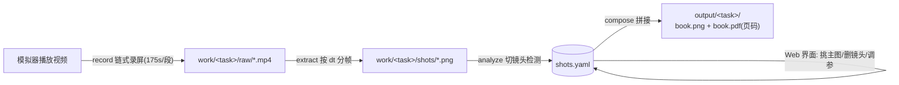
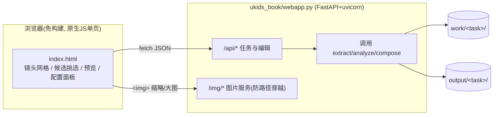
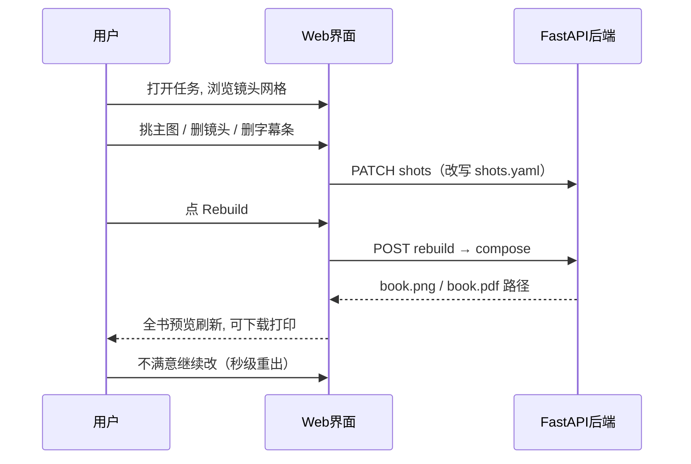

# 半自动截图画册实现方案 v2

> 对应 idea：`doc/idea/202611111906_基于自动截图的视频画册制作方案.md`
> 核心理念：**半自动** —— 机器初排，人通过 Web 界面挑选主图/预览/调参，一键出稿
> 修订：v2（2026-11-11）—— 帧来源改为**录屏+按 dt 分帧**（替代实时截图）；文档图改用 Mermaid；新增 **Web 编辑界面**设计
> v1（实时 screencap 截图）保留为轻量模式，仅快速测试用

## 0. 帧来源决策：录屏 + 分帧（对比结论）

| | 实时截图（v1） | **录屏 → dt 分帧（v2 采用）** |
|---|---|---|
| 采样密度 | ≥1.5s（截图本身 1.1s/张） | 任意 dt，30fps 源 |
| 字幕完整性 | 漏 <2s 短台词 | dt=1s 近乎零漏采（2fps 已验证 230 条/5min） |
| 主图候选池 | 2s 网格采样，常错过最佳瞬间 | 镜头内任意帧，可出多张候选 |
| 参数返工 | 重看视频重拍 | 对录像重跑，分钟级 |
| 单帧质量 | PNG 无损 | H.264 16M 略软（可升 20M） |



## 1. 命令与数据流

| 命令 | 输入 → 输出 | 说明 |
|---|---|---|
| `record`（已有，复用） | 播放中视频 → raw/*.mp4 | 链式 screenrecord 16M，段间 ~0.4s，任务目录隔离 |
| `extract`（新） | raw/*.mp4 → shots/f000123.png | ffmpeg 按 dt（默认 1.0s，下限 0.5s）抽帧 + `frames.json`（帧号→视频时刻）；换 dt 重跑即可，免重录 |
| `analyze`（新） | shots/*.png → shots.yaml | 相邻帧降采样差分 + 自适应阈值（mean+2σ）+ min-shots 钳制；可加候选：每镜头按 `--candidates 3` 均匀补抽主图候选帧 |
| `compose`（改造） | shots.yaml → book.png + book.pdf | 主图裁字幕带 + 序列字幕条（白字字模去重）；PDF 带页码 |
| `make`（新，快捷） | = extract + analyze + compose | 审校前快速预览全书效果 |
| `serve`（新） | 启动 Web 编辑界面 | FastAPI，见 §3；`--task` 均支持名称前缀匹配（取最新任务目录） |

帧命名：`f{序号:06d}.png`（视频时间存 frames.json，界面上换算显示），时间顺序=序号顺序。

## 2. shots.yaml —— 单一事实源

```yaml
meta: {task: E317_20261111_193000, dt: 1.0, threshold: 18.3, min_shots: 4}
shots:
  - id: 1
    main: f000042.png          # 主图（Web 界面点选，默认镜头中间帧）
    candidates: [f000038.png, f000042.png, f000046.png]   # 供挑选的候选
    others: [f000038.png, f000039.png, ...]               # 序列其余帧（字幕条来源）
```

CLI 与 Web 共用此文件：Web 编辑 = 改写 YAML；`compose` 只认 YAML。

## 3. Web 编辑界面

### 3.1 架构



### 3.2 页面与交互

**任务列表页**：work/ 下任务卡片（缩略图、帧数、镜头数、是否已出稿）→ 点进编辑页。

**编辑页（核心）**：
- 左栏：镜头时间线网格——每镜头一张卡片（主图缩略 + 镜头时长 + 字幕条数），可拖动滚动
- 点开镜头 → **候选挑选**：candidates 横向胶片条，点击放大对比，`设为主图` 一键生效（写 YAML）
- **字幕条管理**：others 的字幕条缩略列表，勾选删除（冗余/难看条）
- 镜头级操作：删除镜头、合并到上一镜头
- 右栏：**实时预览**——当前镜头"主图+字幕条"排版效果；切到全书预览（长图滚动 / PDF 逐页）

**配置面板**（右侧抽屉）：
- `dt`（重抽帧）、`threshold` / `min_shots`（重分析）、`candidates 数量`
- PDF 选项：页码开关、装订边宽度
- 应用 = 后端重跑对应步骤（extract/analyze 分钟级，有进度提示），已有人工编辑在重分析前提示确认（会被覆盖）

### 3.3 半自动编辑循环



### 3.4 API 一览

| 方法/路径 | 作用 |
|---|---|
| GET `/api/tasks` | 任务列表 |
| GET `/api/tasks/{t}` | YAML 内容 + 候选/字幕条清单 |
| PATCH `/api/tasks/{t}/shots/{id}` | 改 main / 合并 |
| DELETE `/api/tasks/{t}/shots/{id}` | 删镜头 |
| PATCH `/api/tasks/{t}/shots/{id}/frames` | 删 others 帧 |
| POST `/api/tasks/{t}/reextract` `{dt}` | 重抽帧（警告覆盖分析） |
| POST `/api/tasks/{t}/reanalyze` `{th, min_shots}` | 重分析 |
| POST `/api/tasks/{t}/rebuild` | 重出长图+PDF |
| GET `/img/{t}/{file}` | 图片服务（白名单目录内） |

## 4. 模块与项目结构（2026-11-11 已清理，不留旧包袱）

### 4.1 源码模块

```
ukids_book/
  config.py          # 路径与参数收口（唯一配置点）
  adb.py             # 设备层：定位 adb / shell / pull / screenshot
  capture.py         # record：链式录屏 + 任务目录隔离
  screenshot.py      # shot：即时截图小工具（单张/定时连拍）
  extract.py         # P0 新增：raw → shots/*.png + frames.json（顺带出缩略图）
  shots.py           # P0 新增：切镜头检测 → shots.yaml
  subtitles.py       # 字幕带抠条 + 白字字模去重（strips_from_images）
  compose.py         # 长图 + A4 PDF（装订边交替、页码、垂直居中）
  webapp.py          # P1 新增：FastAPI 应用（127.0.0.1）
  static/index.html  # P1 新增：单页前端（原生 JS，无构建链）
  cli.py             # 命令行入口（唯一入口：record/shot/extract/analyze/compose/make/serve）
```

- **已删除**（存档于 git 快照 a88ae8c，可回溯）：align.py（SRT 对齐）、pipeline.py（旧 build）、segment.py（视频场景检测）、assets/subtitles/（SRT 素材）、work/output 试验产物
- 新增依赖（P1 时装）：`fastapi`、`uvicorn`

### 4.2 项目文件夹结构（含任务工作区）

```
项目根/
├── doc/
│   ├── idea/                        # 原始想法（时间戳命名，只增不改）
│   └── plan/                        # 实现方案（时间戳命名）
├── ukids_book/                      # 源码（见 4.1）
├── scripts/screenshot.py
├── work/                            # 中间产物（gitignore，可整目录删了重建）
│   └── <task>/                      # ★ 每任务一个：<名称>_<YYYYmmdd_HHMMSS>，永不冲突
│       ├── record_meta.json         #   录制分段清单
│       ├── raw/                     #   seg_000.mp4 ...（16M ≈120MB/分钟，一集约 2.5G）
│       ├── shots/                   #   f000000.png ...（dt 分帧 1920×1080）
│       ├── thumbs/                  #   同名 320px 缩略图（Web 网格/长列表用）
│       ├── frames.json              #   帧号 → (段文件, 段内时刻)
│       ├── shots.yaml               #   ★ 镜头序列：CLI 与 Web 共用的单一事实源
│       └── pages/                   #   PDF 逐页预览图（rebuild 时刷新）
├── output/                          # 最终交付（gitignore）
│   └── <task>/
│       ├── book.png                 #   长图（宽 1200px）
│       └── book.pdf                 #   A4 300dpi 带页码，直接打印
├── README.md · requirements.txt · .gitignore
```

数据流即目录流：`raw/ → shots/ → shots.yaml →(Web/CLI 编辑)→ output/`；每个 `<task>` 自包含，删除任务 = 删一个目录。

## 5. 命令行范例

`--task` 统一支持**名称前缀匹配**（自动取 work/ 下最新匹配目录，免敲时间戳）。

```bash
# ── 标准流程：一集（约 21 分钟）──────────────────────────
# ① 模拟器里点开某集播放，立刻录整集
python -m ukids_book.cli record --name E317 --duration 1275

# ② 分帧（默认 dt=1.0s，重跑自动覆盖 shots/）
python -m ukids_book.cli extract --task E317

# ③ 切镜头 → shots.yaml（默认自适应阈值 + min_shots=4）
python -m ukids_book.cli analyze --task E317

# ④ 人工审校：直接编辑 shots.yaml，或开 Web 界面（P1）
python -m ukids_book.cli serve                 # → http://127.0.0.1:8000

# ⑤ 出稿：长图 + 带页码 A4 PDF → output/E317_*/
python -m ukids_book.cli compose --task E317

# ── 快捷与返工 ──────────────────────────────────────────
python -m ukids_book.cli make --task E317            # ②③⑤ 一口气（跳过审校快速预览）
python -m ukids_book.cli extract --task E317 --dt 0.5   # 加密采样，短台词字幕更全（免重录）
python -m ukids_book.cli analyze --task E317 --th 15    # 阈值调低 → 镜头切得更碎
python -m ukids_book.cli compose --task E317 --no-png   # 只出 PDF
python -m ukids_book.cli record --name E318 --duration 1275   # 下一集，新任务目录自动隔离

# ── 截图小工具（与画册流程无关的即时截图）──────────────────
python -m ukids_book.cli shot                # 单张 → work/screenshots/
python -m ukids_book.cli shot -i 30 -c 20    # 每 30 秒一张，共 20 张
```

## 6. 实施计划

| 阶段 | 内容 | 验收 |
|---|---|---|
| P0 | record→extract→analyze→compose CLI 闭环（5 分钟播放实测） | shots.yaml + 长图 + 带页码 PDF |
| P1 | Web 界面：任务列表 + 镜头网格 + 候选挑选 + 预览 + rebuild | 人工改 5 处编辑，秒级重出生效 |
| P2 | 配置面板（重抽帧/重分析/导出选项）、封面页、多集批量合订 | 一季 PDF 合订本 |

## 7. 风险与对策

| 风险 | 对策 |
|---|---|
| Web 重分析覆盖人工编辑 | 重跑前 diff 提示，未改动镜头按 id 保留 main |
| 候选帧太多界面卡 | 缩略图按需生成缓存（extract 时顺带出 320px 小图） |
| H.264 运动帧偏软 | 码率可升 20M；主图候选多挑几帧避开运动模糊 |
| uvicorn 端口冲突/防火墙 | 固定 127.0.0.1 本机访问，不做外网暴露 |
| 175s 段间 ~0.4s 盲区 | 画册场景可容忍；边界帧由字模去重自然处理 |
