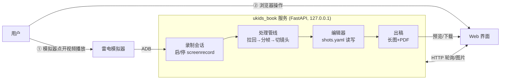
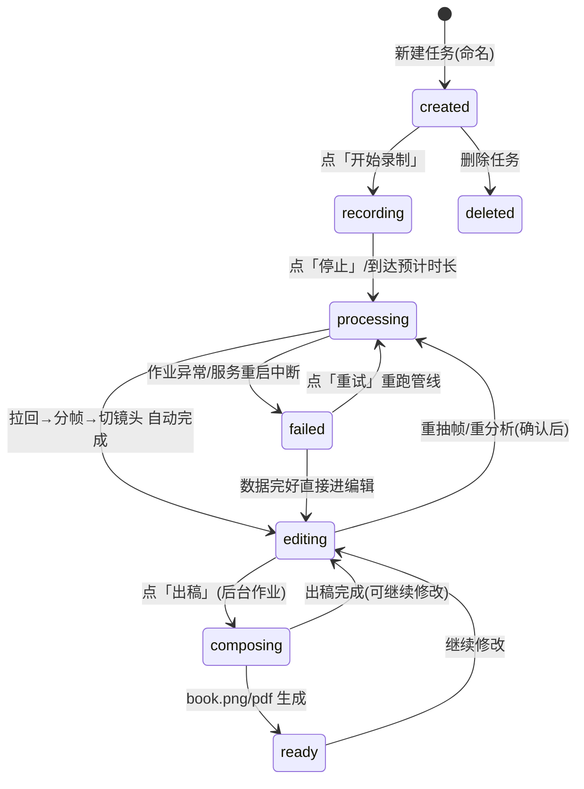
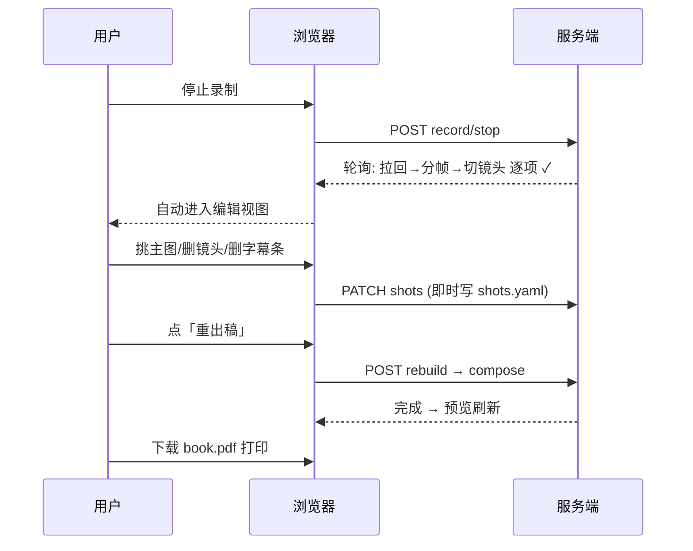

# 半自动截图画册实现方案 v3

> 对应 idea：`doc/idea/202611111906_基于自动截图的视频画册制作方案.md`
> 核心理念：**纯 Web 一条龙** —— 无命令行操作；用户一边在模拟器播放视频，一边在浏览器里启停录制、审校编辑、出稿下载
> 修订：v3（2026-11-11）—— 命令行全面退场，Web 承担 录制控制/处理管线/编辑/预览/配置 全部职责
> v2 要点保留：录屏+按 dt 分帧、shots.yaml 单一事实源、Mermaid 图
>
> review 修订（2026-11-11 实施前）：
> ① 帧格式 PNG→JPEG（q95：1080p PNG 每张约 2MB，一集约 2.5GB；JPEG 约 300KB，打印无感差异），缩略图 JPEG q85
> ② 依赖补 pyyaml（shots.yaml 读写）
> ③ 删除「启动职责移至根目录 start.py」的残留表述，统一为 `python ukids_book/webapp.py` 唯一入口
> ④ failed 状态补恢复路径：数据完好可回 editing，或「重试」重跑 processing
> ⑤ rebuild 也走后台作业（30+ 页 PDF 生成可达数十秒，同步 HTTP 有超时风险），与管线统一进度模型
>
> 首轮试用反馈修订（2026-11-11 晚，全部已实现）：
> ⑥ 主图与字幕条、字幕条之间全部**无缝拼接**（原 pad12/gap8 → 0）
> ⑦ 出稿支持**纸张 A3/A4/A5 + 横纵版**（PATCH /api/tasks/{t} 持久化，配置抽屉选择，出稿时生效）
> ⑧ 镜头编辑支持**帧级重组**：POST /shots/{sid}/move 把勾选帧移到上一/下一镜头或拆分为新镜头（镜头即增删自如）
> ⑨ 编辑弹层：点图**灯箱放大**（←→翻页/Esc 关闭）、**全选/全不选/反选**、帧**时间轴**标注、**字幕条实时预览**（GET /shots/{sid}/strips，与出稿同逻辑）
> ⑩ 响应式布局（<1150px 编辑区纵向堆叠、<920px 录制区堆叠+侧栏折叠为图标）；「有修改未出稿」提示条；下载文件名带任务名
>
> 二轮试用反馈修订（2026-11-11 晚）：
> ⑪ **左侧导航栏**取代顶栏：任务列表/录制/编辑/配置 四入口 + 底部当前任务状态徽章；<920px 折叠为图标栏
> ⑫ 配置抽屉每个参数附**含义说明**（作用、调大调小的影响、默认值与适用场景），仅 ✕ 按钮关闭（空白点击不关闭）
> ⑬ 宽度自适应加固：#main min-width:0、grid 列全 minmax(0,…)（flex+grid 收缩问题）、四档宽度实测零横向溢出
> ⑭ 录制页对「已处理完成的任务」不再自动弹回编辑页，改为提示条引导（自动跳转仅在「看着管线跑完」时触发）
>
> 三轮需求（2026-11-13）：
> ⑮ **文字台词模式**：字幕可不以图片拼接，而由本地 OCR（RapidOCR/onnxruntime）识别成文本后用字体直接排版——`ocr.py` 分行裁剪（EN 0-45%/ZH 45-100% 带高）+2 倍放大+灰度直读（实测空格与双语准确率最佳，二值化反而丢空格），结果缓存 `subs.json` 复用；`compose.py` 新增 `compose_book_text/compose_pdf_text`（EN/ZH 分行折行排版）；任务设置 `subs_mode: image|text`（配置抽屉「字幕形式」），出稿作业首步变为「字幕识别」；弹层字幕条预览带已识别文本；识别为空的条自动跳过
> ⑯ **GPU 加速 OCR**：`config.OCR_DEVICE="dml"`（默认）——rapidocr 仅原生支持 cpu/cuda，故在引擎创建前替换其 `utils.InferenceSession` 注入 DirectML providers（RTX 4070 实测端到端 432→218ms/条 ≈2x，结果与 CPU 一致；依赖 `onnxruntime-directml` 替换 CPU 版 onnxruntime，缺失时自动回退 CPU）
>
> 四轮需求（2026-11-13 下午）：
> ⑰ **台词人工校对**（图片拼接字幕路径整体删除）：弹层「台词校对」区逐帧展示**字幕带截图对照 EN/ZH 输入框**（OCR 预填，改字自动保存 700ms 防抖，留空=该帧不出台词）；「🤖 识别缺失」按钮镜头内即时 OCR（GPU）；subs.json 升级 v2 结构 {帧:{en,zh}}（旧 "EN / ZH" 字符串自动迁移），**人工值永不被 OCR 覆盖**；出稿一律文本排版（compose_book_text/compose_pdf_text，(en,zh) 元组分行折行）；compose 图片条渲染器与 subtitles.strips_from_images 删除；GET /shots 附带 texts 全量缓存，新增 PUT /shots/{sid}/texts 与 POST /shots/{sid}/ocr
> ⑱ **任务复制**（编辑前备份）：POST /api/tasks/{t}/clone——raw/shots/thumbs/strips 硬链接复制（同 inode 零占盘），shots.yaml/frames.json/subs.json 真拷贝（防 write_text 串改源任务）；副本 label 追加「副本」后缀，state 按有无 shots.yaml 定 editing/created。**隔离保证**（已破坏性验证：副本经历改台词/删帧/重抽帧/重出稿后，原任务 8 个关键文件 md5 全部不变）：硬链接目录中的文件只会被「unlink 后重建」（extract._reset_dir），从不在原 inode 上改写；一切原地改写（write_text/replace）只发生在真拷贝的顶层文件上
> ⑲ **任务重命名**：PATCH /api/tasks/{t} {label}——仅改显示名（目录/硬链接不动），VALID_LABEL 允许中英文/数字/空格/._-≤32；卡片「✏️ 改名」为行内编辑（点开变输入框，Enter/失焦保存、Esc 取消），下载文件名与侧栏随之更新
> ⑳ **镜头连续审校**：弹层头部「◀ 上一镜头 / 下一镜头 ▶」按钮 + PageUp/PageDn 快捷键（焦点在输入框时不触发，避免打字冲突）；切换前自动冲刷未落盘的台词防抖保存（已验证 0.7s 内的修改跨镜头不丢失）
> ㉑ **任意帧设主图**：全部帧每帧左上角 ★ 按钮（当前主图绿色实心）原位切换（不重建弹层、不丢滚动位置），左侧网格同步；灯箱（帧图双击放大）内嵌「☆ 设为主图 / ★ 当前主图」按钮，看清大图顺手定主图；PATCH 后 main 自动补进 candidates。前端陷阱：openModal 的 sh 必须 let（applyMain 重绑，const 赋值抛 TypeError 但 PATCH 已成功造成"服务端已改、界面没刷"假象）
> ㉒ **候选主图区与全部帧合并**：候选胶片条删除（★ 已覆盖任意帧），弹层结构简化为 全部帧(★/勾选) + 台词校对。**主图接续审计**（副本实测五项全过）：主图帧移到邻镜头→源镜头自动取剩余中间帧为主、目标镜头主图不变；拆分含主图→新镜头自取中间帧、源镜头换主；删帧主图受保护(400)；全帧移走→镜头自动删除；帧往返移动序恢复。无功能冲突
> ㉓ **OCR 识别率优化**（NeedFOrBlazingSpeed_1 实测）：①单行**五级级联**识别 灰度2x→压暗2x→字模2x→字模3x→压暗3x（深层仅失败行触发；压暗=亮部保留背景×0.35，字模=描边判据二值化）——EN 84%→98%、ZH 59%→76%；②**文本清洗**：播放器控制条文字（选集/倍速/顺序播放/进度时间）整行丢弃，片源水印「剧审网字(2022)」剔片段；③「识别缺失」升级：覆盖镜头全部帧、重试空值行（人工非空值 man 标记永不被覆盖，清空=解除保护即强制重读）；④**邻帧借词** borrow_missing：某语言被播放器控制条物理遮挡时，从英文全等的邻帧借另一语言。剩余 ZH 缺失=录制时控制条遮住字幕（物理无字），人工在弹层补
> ㉔ **相邻同句文本去重**：出稿组行时按**归一化文本相等**（去空白/标点+小写，norm_line）对相邻台词去重、只保留首条——比字模去重（<5% 差异）强，覆盖背景变化/淡入淡出/横跨切点（跨镜头 prev 串联，E318T 实测 22 帧文本→20 条，消除 2 条跨切点重复）；弹层台词校对区对重复行显示「⟲ 与上一条同句 · 出稿只保留一条」标记（跨镜头首行以全局序前一末句为比对起点，随编辑实时更新）
> ㉕ **弹层内成页预览（左右分栏）**：弹层改为**左编辑右预览**两栏（modal 加宽至 1280px；预览列 sticky 吸顶常驻，随台词/主图/识别修改自动刷新；<1150px 窄屏自动回退为上预览下编辑）——服务端用**出稿同一渲染器**实时渲染（GET /shots/{sid}/preview.jpg，880px，含跨镜头同句去重与页面打包，所见即所得），不必退出弹层确认效果。另外弹层不再响应空白点击关闭（只 ✕/Esc），防止编辑台词时误触退出
> ㉖ **每页主图数（用户口径定稿：全局 1/2/4，连续切页，不要自动/手工合并）**：配置抽屉「每页主图数」——1=大图整页（原样）；2=相邻两镜头**左右并排**（各半宽，台词跟图下）；4=四镜头**两行两列**田字格。`pack_pages` 按顺序 N 个一组切页（无智能判断）；`render_page_multi`：1 整页 / 2 左右 / 3-4 田字（格子内图按宽+剩余高双约束缩放居中，2 格字号下限 30px、4 格 34px）；弹层预览为整页级（按当前设置渲该镜头所在整页）。E318T 实测：11 镜头 → 1/页=11 页、2/页=6 页、4/页=3 页。曾实现过 auto 容量配对与 page_join 手工合并，按用户反馈"镜头不由我控制，只要全局数量"**已删除**
> ㉗ **长图形态删除**（用户拍板"必然打印成 PDF"）：rebuild 默认只出 PDF（png 参数保留 API 兼容但前端不再触发），编辑页预览只留逐页模式，工具栏删「⬇长图」
> ㉘ **多主图**（一镜头可出多张图，长场景多给几张画）：①`shots.yaml` 镜头新增 `mains: [帧…]`（≥1，按帧序；main=mains[0] 兼容），`maintain_shot` 统一维护——删帧自动移除该主图、移帧目标镜头吸收、合并并入、拆分跟随；②弹层 ★ 变**多选开关**（点亮多帧=多主图，至少留一张），灯箱「☆加入主图/★移出」同步，标题与卡片显示 主图×N；③**打包单位=镜头**：一个镜头（含全部主图+台词）永远同一页，格内多主图纵向堆叠、台词归最近主图，再按每页镜头数（1/2/4）分页；④弹层预览=该镜头所在**单页**。主图帧可删（mains 自愈），镜头至少留一帧；出稿纯排版不识别（识别在管线第4步「字幕识别」做，重抽帧自动清缓存重识别）
> ㉙ **多主图高度预算共享**（修溢出）：`_cell_block` 旧逻辑每图各自按"格高−自己的台词"缩放，多图叠加溢出纸边（A5 横版尤甚）；改为**台词高度固定不可压，剩余高度按各图自然高度比例分配**（每图同时受格宽约束），保证 Σ(图高+词高)≤格高。三场景像素验证（1镜头3主图整页 / 2镜头各2主图 / 4镜头田字各2主图）底部页边距区均无内容像素
> ㉛ **页底统一台词**（用户定稿版式：台词不跟每张图）：render_page_multi 重构——图片网格在上（择优列数），整页全部镜头台词按序拼接、**紧凑排版**（行距 1.35/条距 0.35，compact 参数）**统一锚定页底**（页码上方，与图片区留 2.5fs 间隔）；fs 全页统一，格子级 fs_min/_cell_* 辅助函数删除。四场景（单图/2图/4图/2镜头）像素验证无越界
> ㉚ **多主图自动网格**（用户：2 张要左右、4 张要田字、按横纵版择优；旧实现一律纵向堆叠）：`_cell_block` 重构——单图走 `_cell_single`（图+词居中）；多图由 `_grid_plan` 在 列数×行数 全部候选里选**单图显示面积最大**的网格（16:9 约束 + 台词高度估算），再逐子格 `_cell_single`。自动适配：横版整页 2 图→2×1 左右、4 图→2×2 田字；纵版高格子可能选单列（图更大）。台词仍跟各自主图。A4 横版实测：2 图左右并排（视觉确认）、4 图四象限均有图（象限检测）；旧值 page_shots="auto" 归一为 "1"（抽屉读取兜底）

## 0. 帧来源决策：录屏 + 分帧（沿用 v2 结论）

| | 实时截图 | **录屏 → dt 分帧（采用）** |
|---|---|---|
| 采样密度 | ≥1.5s（截图本身 1.1s/张） | 任意 dt，30fps 源 |
| 字幕完整性 | 漏 <2s 短台词 | dt=1s 近乎零漏采 |
| 主图候选池 | 2s 网格采样 | 镜头内任意帧，多张候选 |
| 参数返工 | 重看视频重拍 | 对录像重跑，分钟级 |

## 1. 总体流程（纯 Web）



一次成稿的完整闭环：**录制（启停）→ 自动处理（拉回/分帧/切镜头）→ 逐镜头审校（挑主图/删镜头/删字幕条）→ 出稿预览 → 下载打印**，全程浏览器内完成。

## 2. shots.yaml —— 单一事实源（不变）

```yaml
meta: {task: E317_20261111_193000, dt: 1.0, threshold: 18.3, min_shots: 4}
shots:
  - id: 1
    main: f000042.jpg          # 主图（界面点选，默认镜头中间帧）
    candidates: [f000038.jpg, f000042.jpg, f000046.jpg]
    others: [f000038.jpg, f000039.jpg, ...]   # 镜头全部帧（含主图/候选），字幕条由此抠取
```

帧文件为 **JPEG q95**（磁盘占用约为 PNG 的 1/6），缩略图 320px JPEG q85。

## 3. Web 端详细设计

### 3.1 启动与访问

- 启动：`python ukids_book/webapp.py`（可选 `--port 8765 --no-browser`）→ 起 uvicorn（默认 **127.0.0.1:8765**）→ 自动打开默认浏览器；不做 bat、不设根目录启动脚本
- 包内直接跑脚本的相对导入问题：`webapp.py` 开头做 sys.path 引导（把项目根插入 sys.path 后用绝对导入 `from ukids_book import ...`），因此 `python ukids_book/webapp.py` 与 `python -m ukids_book.webapp` 两种方式均可
- 这是用户需要执行的**唯一一条命令**；模拟器与浏览器各占半屏即为工作台
- 技术栈：FastAPI + 原生 JS 单页（`static/index.html`，无构建链、无 CDN），进度用 **1s 轮询**（无 WebSocket 依赖，断线刷新无损）

### 3.2 任务状态机（服务端编排核心）



- 状态与任务数据持久化在 `work/<task>/task.json`，**服务重启不丢**；recording/processing/composing 中的任务重启后标为 failed 并附原因
- 每任务同一时刻只允许一个后台作业（含 rebuild）；作业线程 + 进度写入内存，前端轮询读取；全局仅允许一个任务处于 recording（设备唯一）

### 3.3 页面与交互设计（三个视图，hash 路由单页）

**① 任务列表 `#/tasks`（首页）**

```
┌───────────────────────────────────────────────┐
│ 小小优趣画册工作台            [+ 新建任务____] │
├───────────────────────────────────────────────┤
│ ┌─────────────┐ ┌─────────────┐ ┌───────────┐ │
│ │ E317        │ │ E316        │ │ E315      │ │
│ │ ● 可编辑     │ │ ◐ 处理中68% │ │ ✓ 已出稿  │ │
│ │ 47镜头/21:15│ │ 分帧中       │ │ PDF 27页  │ │
│ │ [打开] [删]  │ │             │ │ [打开][删]│ │
│ └─────────────┘ └─────────────┘ └───────────┘ │
└───────────────────────────────────────────────┘
```
新建任务 = 输入名称（如 E317）→ 创建 `work/E317_<时间戳>/` → 直达录制视图。

**② 录制视图 `#/task/<t>/record`**

```
┌───────────────────────────────────────────────┐
│ E317 · 录制                                    │
│ 提示：先在模拟器里点开视频并播放，再开始录制      │
│ ┌───────────────────────────┐  预计时长(可选)   │
│ │                           │  [21:15 ▼自动停] │
│ │   设备实时画面(2s刷新)      │                  │
│ │                           │  录制 08:32       │
│ └───────────────────────────┘  已录 3 段·412MB  │
│        [ ● 开始录制 ]   [ ■ 停止并处理 ]        │
├───────────────────────────────────────────────┤
│ 停止后自动执行：                                │
│ ✓ 拉回录像(3/3段) → ◐ 分帧(412/1275张) → ○ 切镜头 │
└───────────────────────────────────────────────┘
```
- 实时画面：服务端 2s 一次 `screencap` 缩略图（`/api/tasks/<t>/live`），确认录的内容对
- 停止 = 结束当前段 → 链式自动进入 **pull → extract → analyze**，步骤条实时推进，完成后自动跳转编辑视图
- 预计时长仅用于自动停（默认一集 1275s，可清空改手动停）

**③ 编辑视图 `#/task/<t>/edit`（核心）**

```
┌───────────────────────────────┬───────────────┐
│ 镜头列表(左栏,滚动)             │ 预览(右栏)     │
│ ┌────┐ ┌────┐ ┌────┐ ┌────┐ │ ◉ 长图模式     │
│ │主图│ │主图│ │主图│ │主图│ │ ○ 逐页模式     │
│ │12s │ │8s  │ │15s │ │9s  │ │ ┌───────────┐ │
│ │3台词│ │2台词│ │0台词│ │1台词│ │ │          │ │
│ └────┘ └────┘ └────┘ └────┘ │ │ (预览内容) │ │
│  ...点击打开镜头编辑...        │ │          │ │
│                               │ └───────────┘ │
│ [↻ 重出稿] [⬇PDF] [⬇长图]     │ [配置⚙]       │
└───────────────────────────────┴───────────────┘
   镜头编辑(弹层): 候选胶片条(点选设主图) / 字幕条勾删
                   / [删除镜头] [并入上一镜头]
   配置抽屉: dt重抽帧 · 阈值/min_shots重分析(覆盖警告)
```

- 长图模式：`output/<task>/book.png` 懒加载滚动；逐页模式：`work/<task>/pages/` 翻页
- 所有编辑即时写 `shots.yaml`；「重出稿」秒级重跑 compose 后预览自动刷新

### 3.4 API 设计（REST + 轮询）

| 方法/路径 | 作用 |
|---|---|
| GET `/api/tasks` | 任务列表（名称/状态/统计） |
| POST `/api/tasks` `{name}` | 新建任务 → 任务目录 |
| DELETE `/api/tasks/{t}` | 删除任务（=删目录，二次确认在前端） |
| GET `/api/tasks/{t}` | 任务详情 + 状态 + 作业进度 `{state, job:{kind, progress, log_tail}}` |
| POST `/api/tasks/{t}/record/start` `{duration_hint}` | 开始录制（需 created 状态） |
| POST `/api/tasks/{t}/record/stop` | 停止录制并自动进入处理管线 |
| POST `/api/tasks/{t}/retry` | failed 恢复：shots.yaml 完好→editing；有录像→重跑分帧切镜头；否则→created |
| GET `/api/tasks/{t}/live.jpg` | 录制页设备实时缩略图 |
| GET `/api/tasks/{t}/shots` | shots.yaml 内容（编辑数据） |
| PATCH `/api/tasks/{t}/shots/{id}` `{main?}` | 设主图 / 并入上一镜头 `{merge:true}` |
| DELETE `/api/tasks/{t}/shots/{id}` | 删镜头 |
| PATCH `/api/tasks/{t}/shots/{id}/frames` `{remove:[...]}` | 删 others 帧（字幕条） |
| POST `/api/tasks/{t}/reextract` `{dt}` | 重抽帧（编辑将被覆盖，前端二次确认） |
| POST `/api/tasks/{t}/reanalyze` `{th?, min_shots?}` | 重分析（同上警告；未改动镜头按 id 保留 main） |
| POST `/api/tasks/{t}/rebuild` `{png?, pdf?}` | 重出长图/PDF（**后台作业**，进度同管线轮询） |
| GET `/files/{t}/{kind}/{name}` | 图片服务：kind ∈ shots/thumbs/pages/output；路径白名单校验防穿越 |

### 3.5 服务端模块职责

| 模块 | 职责（v3 变化） |
|---|---|
| `webapp.py` | **编排中枢兼唯一入口**：`python ukids_book/webapp.py` 启动（含 sys.path 引导、uvicorn、自动开浏览器）；路由 + 任务状态机 + 后台作业管理（任务锁+录制全局锁）+ 静态页 |
| `capture.py` | **重构**：`RecordSession` 类（start/stop 可控；停止时 SIGINT 当前段并拉回），替代原定长 record() |
| `extract.py` | 新增：raw → shots/(JPEG q95) + thumbs/(320px q85) + frames.json |
| `shots.py` | 新增：切镜头 → shots.yaml（差分 + 自适应阈值 + min_shots 钳制 + candidates） |
| `compose.py` | 沿用：长图 + A4 PDF（装订边交替、页码、居中）；字幕条解码用 draft 模式提速 |
| `subtitles.py` | 沿用：字幕带抠条 + 白字字模去重 |
| `cli.py` | **删除**（启动职责由 webapp.py 自身承担，无根目录脚本；`screenshot.py` 调试工具随之删除，实时画面由 `/live.jpg` 承担） |
| `adb.py` | 沿用 + 补充：screenrecord 进程管理（pgrep/kill SIGINT 终止当前段） |

### 3.6 编辑循环（时序）



## 4. 项目文件夹结构

```
项目根/
├── doc/{idea,plan}/                 # 文档（时间戳命名）
├── ukids_book/
│   ├── config.py                    # 路径与参数收口
│   ├── adb.py                       # 设备层（shell/pull/screenshot/录屏进程）
│   ├── capture.py                   # RecordSession：可控录屏
│   ├── extract.py                   # 分帧 + 缩略图
│   ├── shots.py                     # 切镜头 → shots.yaml
│   ├── subtitles.py                 # 字幕带 + 字模去重
│   ├── compose.py                   # 长图 + A4 PDF
│   ├── webapp.py                    # FastAPI 编排中枢 · 唯一入口（python ukids_book/webapp.py）
│   └── static/index.html            # 单页前端（原生 JS）
├── work/<task>/                     # task.json · raw/ · shots/ · thumbs/ · strips/ · frames.json · shots.yaml · pages/
├── output/<task>/                   # book.png · book.pdf
├── README.md · requirements.txt · .gitignore
```

依赖：`pillow`（已有）+ `fastapi`、`uvicorn`、`pyyaml`。

## 5. 操作范例（用户视角，全程无命令行）

1. `python ukids_book/webapp.py` → 浏览器自动打开工作台
2. 新建任务 `E317` → 模拟器里点开该集播放 → 点「开始录制」（预计时长默认 21:15 自动停，或手动停）
3. 等待自动处理完成（进度条 1~2 分钟）→ 自动进入编辑视图
4. 逐镜头审校：换主图、删废镜头、勾删冗余字幕条
5. 「重出稿」→ 右侧预览 → 满意后下载 `book.pdf` 打印
6. 下一集：新建任务 `E318` 重复 2~5；各任务目录天然隔离

返工同样在 Web 内：配置抽屉改 dt/阈值 → 确认覆盖 → 自动重跑对应步骤。

## 6. 实施计划

| 阶段 | 内容 | 验收 |
|---|---|---|
| P0 | webapp 骨架 + 任务状态机 + RecordSession + 自动管线（extract/analyze）+ 编辑视图最小版（镜头网格/设主图/删镜头）+ rebuild/预览 | 浏览器完成一集：录制→自动处理→改 3 处→出稿下载 |
| P1 | 编辑体验完善：候选胶片条、字幕条勾删、合并镜头、逐页预览、配置抽屉（重抽帧/重分析） | 人工审校全功能可用，重跑有覆盖警告 |
| P2 | 封面页、多集批量出稿、PDF 导出选项、长图模式优化 | 一季合订本 |

## 7. 风险与对策

| 风险 | 对策 |
|---|---|
| 录制 20+ 分钟期间浏览器关闭/刷新 | 作业在服务端线程执行，状态落 task.json，重开页面恢复显示 |
| 停止录制时当前段损坏 | 终止 screenrecord 进程后按已有段处理；损坏段跳过并记录日志 |
| 重分析覆盖人工编辑 | 覆盖警告 + 未改动镜头按 id 保留 main |
| 前端图片多加载慢 | thumbs/ 320px 缩略 + 长图懒加载；大图按需加载 |
| 端口占用/防火墙弹窗 | 固定 127.0.0.1:8765 仅本机；启动失败提示换端口参数 |
| 多任务并发录制 | 设备只有一台：同一时刻仅允许一个任务处于 recording（全局锁） |
